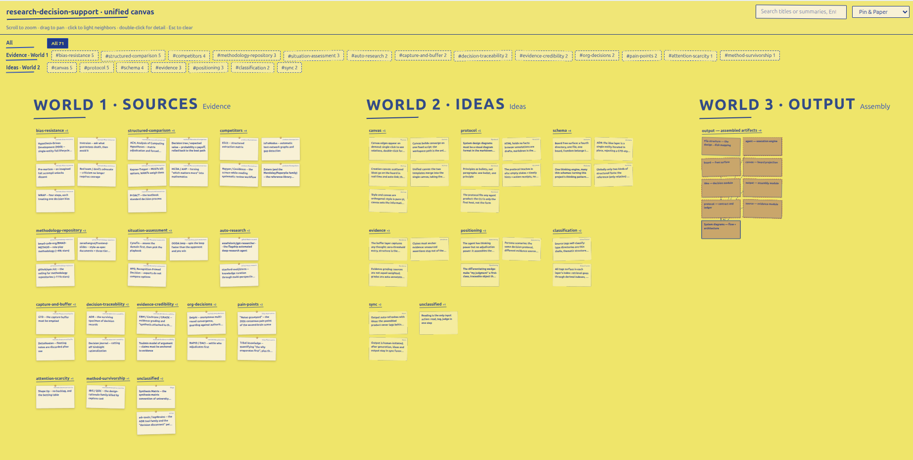

<h1 align="center">py-harness</h1>

**Turn scattered reading and half-formed ideas into a design you can defend** —
a skill, a system, a video script, even the structure of an article.
The human adjudicates, the agent runs the errands.

An Agent Skill (Claude Code plugin, works with any
SKILL.md-compatible agent): feed it sources and rough ideas as you go — it files
and links them, records how your thinking evolves, and assembles the evidence into
a system design.

Markdown keeps the record; the canvas makes it readable — every source and idea
you add lands on the board, one glance away from any decision's why.

